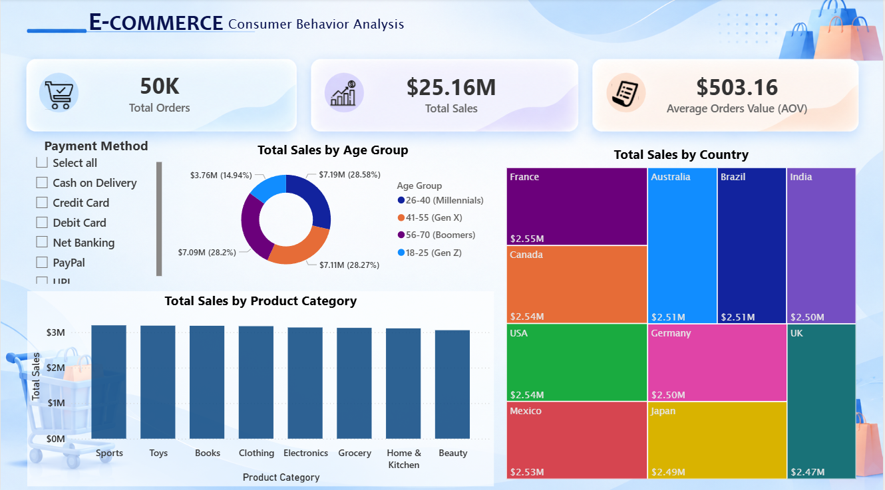

# E-Commerce Consumer Behavior Analysis 🛍️

## 📌 Project Overview
This project analyzes a synthetic dataset of 50,000 e-commerce transactions to identify sales trends, customer segments, and purchasing behaviors across 10 countries. 

## 🛠️ Tech Stack & Data Pipeline
To showcase a complete data analytics workflow, this project is divided into 4 main stages:
1. **Excel:** Initial data assessment and raw data inspection.
2. **Python (Google Colab):** Advanced data cleaning, formatting dates, and age-group binning using Pandas.
3. **MySQL:** Database ingestion and complex SQL querying to extract business insights.
4. **Power BI:** Building an interactive executive-ready dashboard.

## 📁 Repository Structure
* `/data` : Contains the raw and cleaned datasets.
* `/notebooks` : Jupyter Notebook (`.ipynb`) used for Python data cleaning.
* `/sql` : Production-ready `.sql` files containing analysis queries.
* `/dashboard` : The Power BI dashboard file (`.pbix`) and screenshots.

## 📊 Key Insights & Business Recommendations

### 1. Sales & Product Performance
*   **Insight:** **Sports** emerged as the primary revenue driver, contributing the highest total sales of **$3.19M**, closely followed by other categories. On the other hand, **Beauty** generated the lowest revenue, yielding **$3.06M**. The narrow margin across all categories indicates a highly balanced product distribution profile in this market.
*   **Recommendation:** Since the revenue gap between the highest and lowest categories is minimal, the marketing team should focus on cross-selling strategies. Implement promotional bundles, such as offering a discount on underperforming Beauty products when a customer purchases high-demand Sports gear, to lift overall profit margins.

### 2. Customer Segmentation & Generative Behavior
*   **Insight:** **Millennials (Aged 26-40)** represent the most lucrative customer segment, dominating the consumer base by contributing **28.58%** of total transactions and generating **$7.19M** in revenue. Geographically, **France** is the top-performing market, leading all 10 analyzed countries with **$2.55M** in total sales.
*   **Recommendation:** Launch a loyalty reward program specifically designed to appeal to Millennials, as they hold the highest purchasing power. Concurrently, scale up localized digital advertising campaigns in France to solidify market leadership, while investigating localized pricing hooks for lower-performing regions.

### 3. Payment Method Optimization
*   **Insight:** Purchasing behaviors vary distinctly across different generations. **Gen Z** buyers predominantly utilize digital payment gateways like **Credit Card and PayPal**. Conversely, older demographics (**Boomers**) rely heavily on bank-direct options such as **Net Banking and UPI**.
*   **Recommendation:** Dynamic checkout optimization is required. The e-commerce platform should display preferred payment gateways at the top of the payment screen based on the user's logged-in age profile (e.g., highlighting PayPal for Gen Z and prioritizing Net Banking/UPI options for Boomers) to reduce friction and minimize cart abandonment rates.

## 📈 Dashboard Preview

